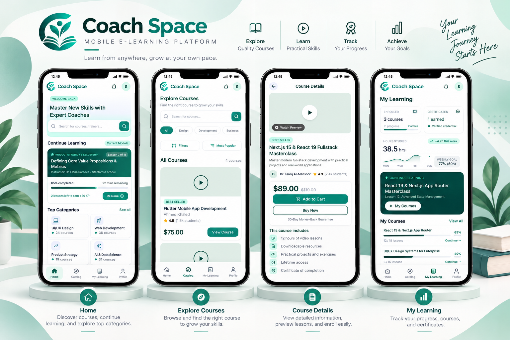
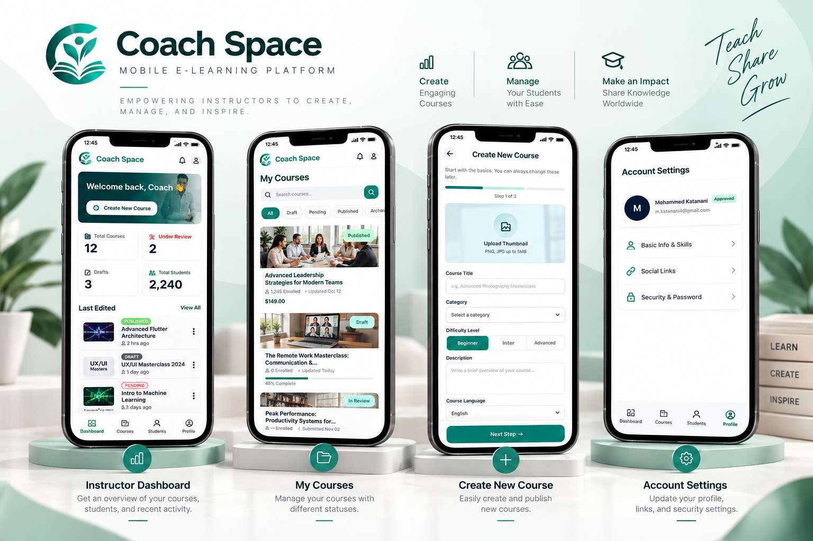

# Coach Space

<p align="center">
  
</p>

<h3 align="center">A Mobile E-Learning Platform for Students and Instructors</h3>

<p align="center">
  A collaborative Flutter project designed to support online learning and course management.
</p>

<p align="center">
  
  
  
</p>

<p align="center">
  
  
  
</p>

---

## Overview

**Coach Space** is a team-developed mobile e-learning application built with Flutter and Dart. It aims to provide a convenient learning environment for students and a set of course management tools for instructors.

The application brings together course discovery, learning management, student progress, and instructor tools in one platform.

The project uses a feature-based structure and reusable components to support maintainability and future development.

## Key Features

### Student Features

- **Authentication:** Register and log in to the application.
- **Course Catalog:** Browse and explore available courses.
- **Course Details:** View course information and available learning content.
- **Search and Filtering:** Find courses using available search and filtering options.
- **Cart and Checkout:** Manage selected courses and access the checkout flow.
- **My Learning:** Access enrolled courses and learning content.
- **Progress Tracking:** Follow lesson and course progress.
- **Certificates:** Access course completion certificates.
- **Student Profile:** Manage profile information and account settings.
- **Learning Path:** Explore learning goals and roadmap-related features.

### Instructor Features

- **Instructor Dashboard:** View course-related information and statistics.
- **Course Management:** Create, edit, and manage courses.
- **Content Management:** Organize course sections, lessons, and learning materials.
- **Student Management:** View enrolled students and their progress.
- **Instructor Profile:** Manage profile information and settings.
- **Notifications:** Access instructor notifications.
- **Course Review Workflow:** Track course approval and review status.

## Tech Stack

| Technology | Purpose |
|---|---|
| Flutter | Cross-platform mobile application development |
| Dart | Application programming language |
| flutter_bloc | State management with Bloc and Cubit |
| Dio | HTTP networking |
| Retrofit | API service definitions and code generation |
| GetIt | Dependency injection |
| Equatable | Value-based equality |
| json_annotation | JSON serialization annotations |
| json_serializable | JSON model code generation |
| build_runner | Code generation |
| flutter_secure_storage | Secure local storage |
| flutter_localizations | Flutter localization support |
| intl | Internationalization utilities |

## Architecture

Coach Space follows a feature-based architecture that separates shared application components from individual features.

```text
lib/
├── core/
│   ├── auth/
│   ├── di/
│   ├── networking/
│   ├── routing/
│   ├── theming/
│   └── ...
├── features/
│   ├── auth/
│   ├── instructor/
│   ├── onboarding/
│   ├── signup/
│   ├── splash/
│   └── student/
├── l10n/
└── main.dart
```

### Architecture Highlights

- **Separation of Concerns:** Shared components and feature-specific code are organized separately.
- **State Management:** Bloc and Cubit are used to manage application state.
- **Dependency Injection:** GetIt is used to register and access dependencies.
- **Navigation:** Application routes are managed through a centralized routing setup.
- **Networking:** Dio and Retrofit are included for API communication.

## Localization

The project includes Arabic and English localization resources.

The localization setup uses Flutter's localization infrastructure and supports localized application interfaces.

## Getting Started

### Prerequisites

- Flutter SDK 3.44.7 (stable) or a compatible version.
- Dart SDK 3.12.2 or a compatible version.
- Android Studio or another supported Flutter development environment.

### Installation

**1. Clone the repository**

```bash
git clone https://github.com/Coachspacs/Coachspacs_App.git
```

**2. Navigate to the project directory**

```bash
cd Coachspacs_App
```

**3. Install dependencies**

```bash
flutter pub get
```

**4. Generate required files**

```bash
dart run build_runner build --delete-conflicting-outputs
```

**5. Run the application**

```bash
flutter run
```

> If generated files are already available, code generation may not be necessary for every run. Run it again when generated models or API services change.

## Project Structure

- `lib/core/` — Shared application services, routing, theming, and dependency injection.
- `lib/features/auth/` — Authentication-related functionality.
- `lib/features/student/` — Student-facing application features.
- `lib/features/instructor/` — Instructor-facing application features.
- `lib/l10n/` — Localization resources.
- `assets/` — Images and other application assets.

## App UI Showcase

Coach Space provides dedicated experiences for students and instructors.

### Student Experience

Explore the student interface, including course discovery, learning progress, and course details.



### Instructor Experience

Explore the instructor interface, including dashboard insights, course management, and instructor tools.



---


## Project Status

**In Development**

Coach Space is an ongoing team project. Features and implementation details may evolve as development continues.

## Team Collaboration

Coach Space is developed collaboratively. The project brings together UI development, application logic, state management, navigation, and API integration to build a mobile e-learning platform.

---

<p align="center">
  <strong>Coach Space</strong>
  <br />
  Empowering learning through technology.
</p>
